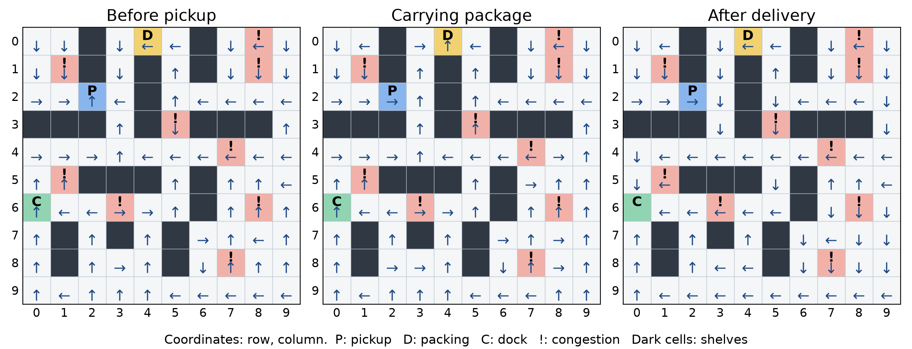
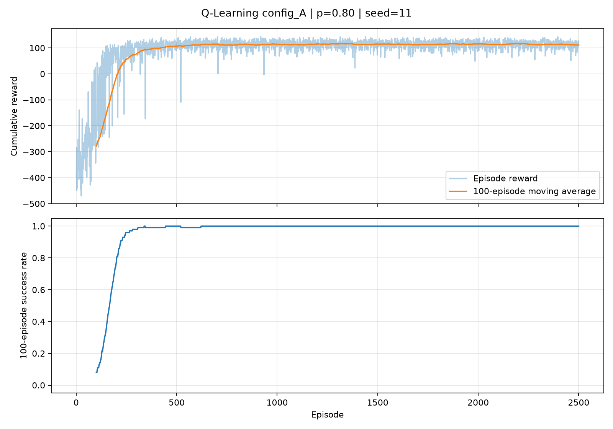
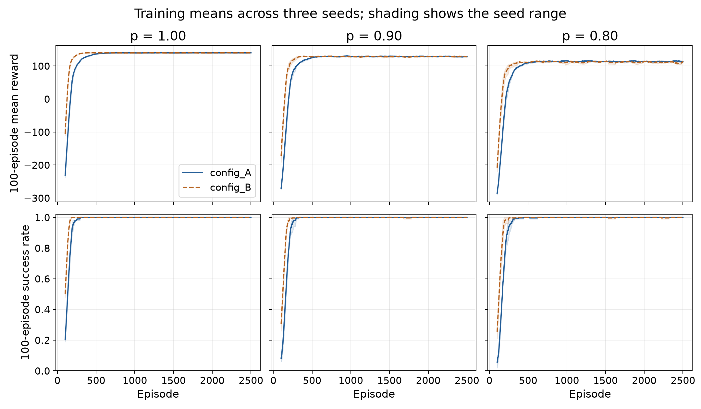
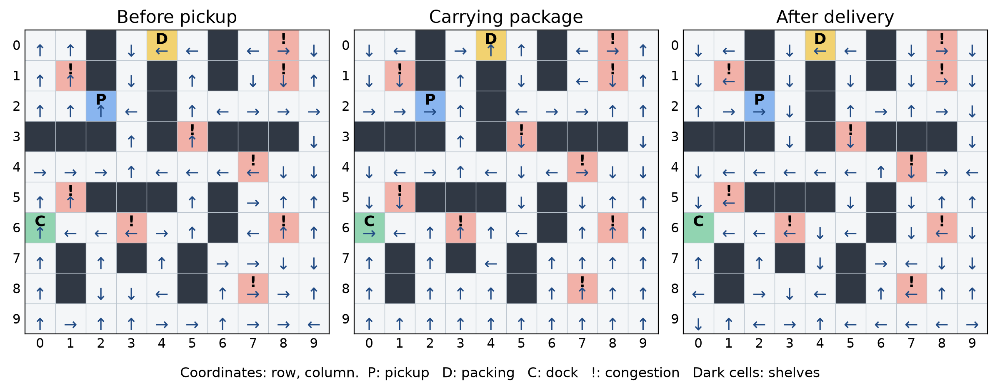
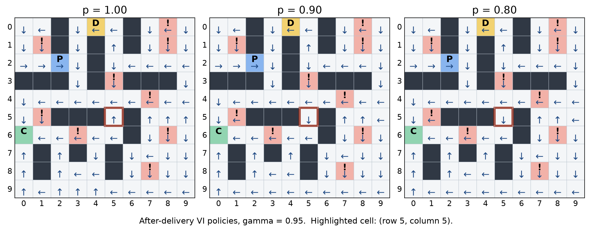
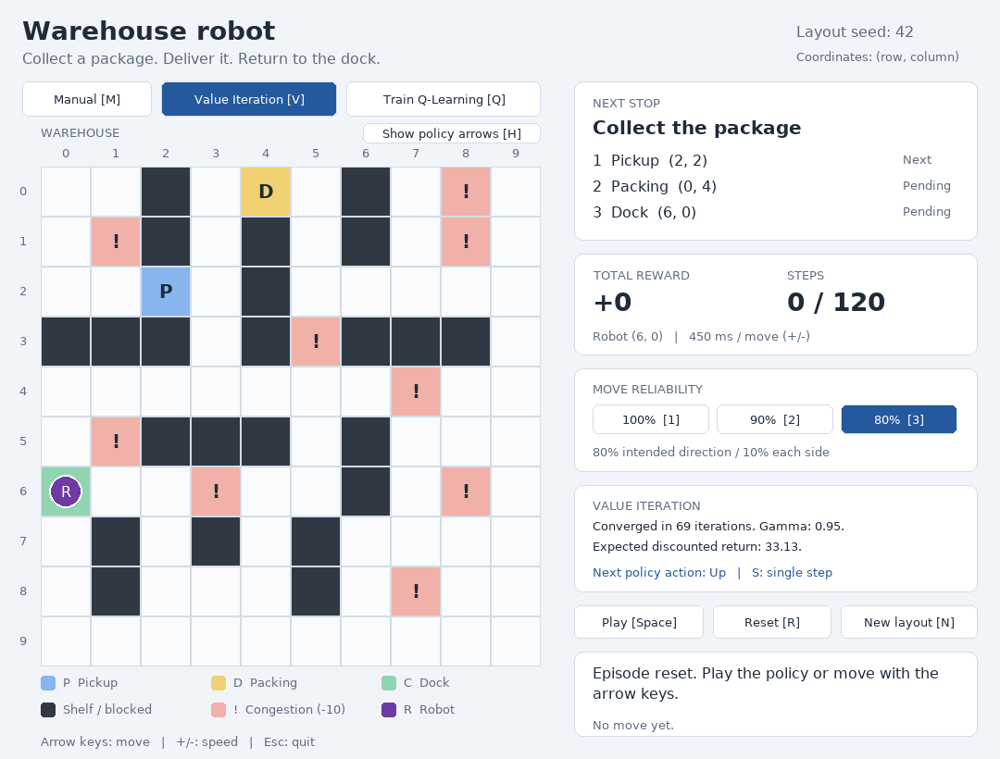

# Warehouse Robot Decision Making

## Dynamic Programming and Reinforcement Learning

**COSC-4117EL-01 · Artificial Intelligence · Fall 2026**  
**Assignment 2**  
**Group:** {{GROUP}}  
**Members:** {{MEMBERS}}

{{REPOSITORY_LINK}}

{{READINESS_NOTE}}

### Abstract

This project applies Value Iteration and tabular Q-Learning to the instructor-provided 10 × 10 warehouse environment. A robot collects a package, delivers it to a packing station, and returns to its charging dock. The experiment compares two learning configurations, three random training seeds, and intended-action probabilities of 1.00, 0.90, and 0.80, while keeping the warehouse layout fixed. Each of the 18 Q-Learning runs uses 2,500 training episodes and 100 greedy evaluation episodes, with a matched Value Iteration baseline.

At the required probability of 0.80, Value Iteration converges in 69 sweeps with γ = 0.95 and θ = 0.00001. Configuration A achieves a mean evaluation return of 119.30, compared with 119.37 for its matched Value Iteration baseline. Every evaluated policy completes all 100 evaluation episodes in each run. Lower motion reliability reduces rewards even when success remains unchanged. The results show similar behaviour along evaluated routes, but do not establish that Q-Learning recovers the optimal policy in every state.

### Report organization

1. Introduction
2. MDP formulation
3. Part 1 — Value Iteration
4. Part 2 — Q-Learning
5. Part 3 — Stochastic motion
6. Value Iteration versus Q-Learning
7. Environment and interface changes
8. Limitations
9. Group information
10. Generative AI acknowledgment

Appendices provide verification results, reproduction commands, and a detailed AI-assistance record. All reported measurements come from the submitted experiment CSVs and their independently rerun analysis; no missing experiment results have been estimated.

<div class="pagebreak"></div>

## 1. Introduction

The warehouse robot must complete an ordered task: charging dock → pickup station → packing station → charging dock. Shelves block movement. Congestion cells remain traversable but impose a penalty, so a short route may be less rewarding than a longer route. Movement uncertainty adds another trade-off: an intended action can produce a perpendicular movement, potentially causing a collision or entry into congestion.

Value Iteration plans using the known transition and reward model. Q-Learning estimates action values from observed interactions. Comparing them in the same warehouse isolates how model knowledge, exploration, and motion uncertainty affect performance. Parts 1 and 2 use p = 0.80; Part 3 also tests p = 0.90 and p = 1.00. The implementation uses the supplied environment rather than a replacement simulator.

All reported experiments use layout seed **42**. Coordinates are zero-based `(row, column)`: the dock is **(6, 0)**, pickup is **(2, 2)**, and packing is **(0, 4)**. The provided program seeds station placement; shelves and congestion cells are fixed. Different seeds can therefore produce station locations different from the assignment illustration without changing the framework. Training seeds 11, 22, and 33 change motion and exploration, while leaving the layout unchanged.

## 2. MDP Formulation

### State space and task progress

The state is `s = (row, column, has_package, delivered)`. Position alone is insufficient: arriving at the packing station before pickup earns no delivery reward, whereas arriving with the package does. Likewise, returning to the dock terminates the task only after delivery. Including progress makes the next-state and reward rules depend on the current state and action rather than the earlier route.

| Progress flags | Meaning | Next task objective |
|---|---|---|
| `(0, 0)` | Package not yet collected | Pickup station |
| `(1, 0)` | Package collected, not delivered | Packing station |
| `(1, 1)` | Package delivered | Charging dock |

The supplied environment keeps `has_package = 1` after delivery, so this flag acts as a pickup-history flag in the last stage. The combination `(0, 1)` is excluded. There are 77 non-shelf cells and three stage combinations, giving **231 enumerated states** and **924 state-action entries**. This enumeration includes the terminal state and some position/stage combinations that are unreachable from the normal reset state; it is not a claim that all 231 states occur during training.

### Actions and transitions

`A = {up, down, left, right}`. All four actions are available, including attempts toward shelves or boundaries. For intended action a, the actual movement is a with probability p and each perpendicular direction with probability `(1 − p) / 2`. There is no opposite-direction outcome. For example, intended up produces up/left/right with probabilities 0.80/0.10/0.10 in Parts 1 and 2.

Each movement outcome first attempts to change position. An invalid move leaves position unchanged, after which the original reward and task-progress rules are applied. The probability `P(s′ | s, a)` is the sum of probabilities of movement outcomes producing s′. The implementation sums these branches directly, so probability is preserved when different outcomes lead to the same next state. If such branches have different rewards, `R(s, a, s′)` can be interpreted as their conditional expected reward.

<div class="pagebreak"></div>

### Reward model

Rewards are additive and are taken directly from the supplied environment.

| Event | Added reward | Condition |
|---|---:|---|
| Time step | −1 | Every action |
| Invalid movement | −3 | Shelf or out-of-bounds attempt |
| Congestion | −10 | Resulting cell is a congestion cell |
| Pickup | +25 | Pickup station, package not previously collected |
| Delivery | +40 | Packing station after pickup, before first delivery |
| Return | +100 | Dock after delivery; successful termination |

An ordinary pickup step earns 24, delivery earns 39, and successful return earns 99 after the step cost. An invalid move on ordinary floor earns −4. The original congestion rule also applies when an invalid move leaves the robot on a congestion cell; that step earns −14. Pickup and delivery rewards cannot be repeatedly collected after their flags change.

The baseline discount factor is **γ = 0.95**. The objective is expected discounted return, `E[Σ γᵗ rₜ₊₁]`, until successful completion. Configuration B also tests γ = 0.90. Evaluation reports the **undiscounted sum of rewards within each episode**, which is distinct from the value function's discounted return.

### Episode limit and planning objective

**Episode limit: 120 environment steps; no wall-clock deadline.** Each action, including an invalid move, consumes one step. GUI playback speed does not change this limit. Successful return to the dock after delivery terminates the task with zero future value. Returning earlier does not finish the task. Reaching the step limit without success ends the episode and counts as an evaluation failure.

**Planning choice: a discounted task until successful return, sampled in step-bounded episodes.** The four-element state is Markov for movement, rewards, and task progress. VI plans without a fixed step horizon; Q-Learning treats the 120-step cutoff as external truncation and retains its next-state estimate in that update. Remaining steps are absent from the state, so the policy does not adapt to an approaching cutoff. An exact 120-step-optimal formulation would index values and policies by steps remaining, or add that counter to the state. The reported policies optimize the stated discounted model; no exact finite-horizon optimality claim is made.

### Shared experiment controls

| Setting | Value |
|---|---|
| Environment | Supplied 10 × 10 warehouse, layout seed 42 |
| Baseline transition | p = 0.80; perpendicular outcomes 0.10 each |
| Additional transitions | p = 0.90 and p = 1.00 |
| Step limit | 120 per episode |
| Training seeds | 11, 22, 33 |
| Evaluation seeds | 511, 522, 533, respectively |
| Evaluation | 100 episodes per trained policy and matched VI baseline |

<div class="pagebreak"></div>

## 3. Part 1 — Value Iteration

### Implementation

`value_iteration.py` initializes V(s) = 0 for every enumerated state. Each synchronous sweep calculates new values from the previous sweep:

<div class="equation">V<sub>k+1</sub>(s) = max<sub>a</sub> Σ<sub>s′</sub> P(s′ | s, a) [R(s, a, s′) + γ V<sub>k</sub>(s′)]</div>

For a successful transition, the future-value term is zero. The terminal state remains at zero. Sweeps continue until `max_s |V_new(s) − V_old(s)| < θ`, with **θ = 0.00001** and **γ = 0.95**. The policy is then extracted again using the final values and the action with maximum expected return. Ties use the first action in the order up, down, left, right.

At p = 0.80, convergence takes **69 sweeps**. The discounted value of the initial dock state is **33.128917**. This value is not the evaluation mean reward because rewards are discounted and the model does not impose the 120-step cutoff.

| Intended-action probability | Sweeps to threshold | Discounted V(start) |
|---:|---:|---:|
| 1.00 | 31 | 60.737270 |
| 0.90 | 55 | 47.812159 |
| **0.80** | **69** | **33.128917** |

*Source: `outputs/value_iteration_summary.csv`. All rows use γ = 0.95 and θ = 0.00001.*

### Final policy



*Figure 1. Value Iteration policy at p = 0.80 and γ = 0.95, shown separately before pickup, while carrying, and after delivery. Coordinates are row/column. P = pickup, D = packing, C = dock, ! = congestion; dark cells are shelves. The final-stage terminal dock has no action. Arrows at unreachable position/stage combinations are part of the enumeration, not evidence that those states are visited.*

The three maps show why a single arrow per physical cell is insufficient: the target changes with task progress. Value Iteration requires a known model because every action update explicitly calculates expected returns over possible next states, using both their probabilities and rewards. It requires no exploratory training episodes, but its sweeps are not directly comparable to Q-Learning episode counts.

<div class="pagebreak"></div>

## 4. Part 2 — Q-Learning

### Implementation and configurations

`q_learning.py` initializes four action values to zero for every enumerated state. At each training step, an ε-greedy rule selects a uniformly random action with probability ε and otherwise selects an action with the highest Q value. Ties use the same action order as Value Iteration. The update is:

<div class="equation">Q(s, a) ← Q(s, a) + α [r + γ max<sub>a′</sub> Q(s′, a′) − Q(s, a)]</div>

For a successful return to the dock, the target is just r. For other transitions, including a timeout, the target includes the discounted next-state estimate. Both success and timeout stop the current episode. No transition model is used to compute this update.

| Configuration | Learning rate α | Discount γ | ε multiplier per episode |
|---|---:|---:|---:|
| A — baseline | 0.15 | 0.95 | 0.995 |
| B — alternative | 0.30 | 0.90 | 0.990 |

Each run has **2,500 episodes**, starts at ε = 1.00, and applies `ε ← max(0.05, ε × decay)` after each episode. The remaining 5% exploration helps explain why late training reward is lower than greedy evaluation reward. Configuration B learns more aggressively, discounts future rewards more strongly, and reduces exploration faster. Because all three settings change together, this experiment compares configurations; it cannot isolate the effect of one hyperparameter.

Each configuration is tested at p = 1.00, 0.90, and 0.80 with seeds **11, 22, 33**, giving **18 runs and 45,000 training episodes**. The environment motion generator is reset to the training seed; the independent action-selection generator uses `seed + 10000`. Prior evaluation cannot change a run's subsequent training results. The layout remains seed 42 throughout.

### Evaluation and recorded evidence

After training, the greedy policy selects `argmax Q(s, a)` with exploration disabled. Motion remains stochastic when p < 1. The evaluation generator uses `training seed + 500` and draws a new motion seed for each of 100 episodes. Value Iteration uses the same evaluation-seed procedure, p, layout, γ, and step limit for its corresponding comparison. Equal random seeds provide matched random streams, although different actions may produce different trajectories.

For every training episode, the program saves total reward, success (0/1), and ε. It also saves the first greedy evaluation path, three stage-policy images, learning curves, and a summary row. Success means delivery followed by return to the dock within the step limit; merely reaching the packing station or exhausting the step limit is not success.

The saved evidence was rerun and compared: all **45,000 reward/success/ε records**, **18 first-evaluation paths**, and evaluation summaries reproduced. The following figures and tables use these measurements.

<div class="pagebreak"></div>

### Learning behaviour and approximate convergence



*Figure 2. Baseline Q-Learning at p = 0.80, seed 11. The upper panel shows the cumulative reward within each individual episode and its trailing 100-episode mean. The lower panel shows the trailing success fraction. Both moving averages are placed at the last episode in their window. Source: `outputs/config_A_p_0.80_seed_11_episodes.csv`.*

The baseline begins with poor rewards because exploratory actions waste steps, incur penalties, and often time out. Rewards improve rapidly in the first few hundred episodes. The curve then fluctuates around a relatively stable level because movement is stochastic and ε remains 0.05. For this run, the final 100 training episodes average **110.72**, while the greedy evaluation averages **120.82**. These are different measures: the latter disables exploration.

To make the early-learning comparison reproducible, we record the first endpoint of a trailing 100-episode window with at least 95% success. This is an operational learning milestone, not a proof of Q-value convergence or a guarantee that every later window meets the threshold. Visual reward stabilization occurs roughly within the first **300–600 episodes**, depending on configuration and p. Constant α and continuing exploration mean finite training does not establish exact convergence to Q*.

<div class="pagebreak"></div>



*Figure 3. Learning across all motion settings. Lines are the mean of the three seeds' trailing 100-episode averages. Shading spans the minimum and maximum across seeds, not a confidence interval. Solid blue = A; dashed orange = B. “Reward” is each episode's cumulative undiscounted reward, averaged over the window.*

| p | A: first ≥95% window endpoint | B: first ≥95% window endpoint |
|---:|---:|---:|
| 1.00 | 190–211 | 154–157 |
| 0.90 | 222–285 | 170–184 |
| 0.80 | 231–289 | 170–197 |

*Ranges cover seeds 11, 22, and 33. Source: `report/analysis_summary.json`, computed from per-episode CSVs.*

Configuration B reaches this milestone earlier in every tested setting. However, its final mean evaluation reward is almost identical to A at p = 0.90 and slightly lower at p = 0.80. Faster initial learning therefore does not establish a better final policy. Increasing uncertainty slows the milestone for A and reduces the eventual reward level for both configurations.

Across the three p = 0.80 runs, A's greedy evaluation means range from **118.12 to 120.82**, and B's range from **117.48 to 120.44**. Every run achieves 100/100 successes. This supports repeatability across the tested training and evaluation streams on this layout. It does not measure generalization to other station layouts or establish a population failure probability of zero.

<div class="pagebreak"></div>

### Greedy policy demonstration

The recorded demonstration uses **A, p = 0.80, training seed 11, evaluation seed 511**, and the first evaluation episode. Every intended action is greedy; environmental slips remain enabled. The robot completes the task in **33 steps** with total reward **107**.

| Step | Resulting position / event | Step reward | Total reward |
|---:|---|---:|---:|
| 0 | Dock (6, 0), no package | — | 0 |
| 4 | Slip into congestion (5, 1) | −11 | −14 |
| 16 | Pickup (2, 2), flags become (1, 0) | +24 | −13 |
| 22 | Delivery (0, 4), flags become (1, 1) | +39 | +21 |
| 33 | Return to dock (6, 0), success | +99 | +107 |

The full trace contains 33 step penalties, one congestion penalty, and five invalid-move penalties. Its total independently reconciles as `25 + 40 + 100 − 33 − 10 − 5×3 = 107`. The state sequence is in `outputs/config_A_p_0.80_seed_11_greedy_path.csv`; the expanded trace, including intended versus actual actions and rewards, is in `report/greedy_demo_trace.json`.



*Figure 4. Greedy Q-Learning policy for this demonstration, shown in all three task stages. Symbols and coordinates match Figure 1. Many distant states have little or no training experience; arrows there can reflect tied or poorly estimated Q values. A complete map should therefore be interpreted alongside the actual evaluated routes.*

The demonstration illustrates recovery rather than perfect motion: at step 4, an intended right action moves down into congestion. Later slips also cause blocked movements. The learned policy still reaches the pickup, delivers, and returns. Its return of 107 is one realized episode, not the 100-episode evaluation mean of 120.82.

<div class="pagebreak"></div>

## 5. Part 3 — Stochastic Motion

### Reward, success, and convergence comparison

| Config. | p | Q-Learning return | Matched VI return | Q / VI success | VI sweeps |
|---|---:|---:|---:|---:|---:|
| A | 1.00 | 143.00 ± 0.00 | 143.00 ± 0.00 | 100% / 100% | 31 |
| A | 0.90 | 133.11 ± 0.24 | 133.19 ± 0.25 | 100% / 100% | 55 |
| A | 0.80 | 119.30 ± 1.13 | 119.37 ± 1.11 | 100% / 100% | 69 |
| B | 1.00 | 143.00 ± 0.00 | 143.00 ± 0.00 | 100% / 100% | 31 |
| B | 0.90 | 133.11 ± 0.25 | 133.19 ± 0.25 | 100% / 100% | 51 |
| B | 0.80 | 119.03 ± 1.21 | 119.37 ± 1.11 | 100% / 100% | 64 |

*Each return is the mean ± population standard deviation of the three run-level means, each based on 100 evaluation episodes. The standard deviation summarizes these three runs; it is neither an episode-level standard deviation nor a confidence interval. A's VI baseline uses γ = 0.95; B's uses γ = 0.90. All VI runs use θ = 0.00001. Source: `outputs/q_learning_experiment_results.csv` and `report/analysis_summary.json`.*

At p = 1.00, evaluated routes complete in 22 steps without congestion or invalid-move costs, yielding `165 − 22 = 143`. With uncertainty, slips can add steps, collision penalties, and congestion penalties. This reduces average return even though every tested episode still finishes within 120 steps. For A, the reduction from p = 1.00 to 0.80 is **23.70 reward units**.

Value Iteration requires more sweeps as p decreases: 31 → 55 → 69 at γ = 0.95. Its values must incorporate repeated stochastic outcomes and possible self-loops. With γ = 0.90, the observed counts are 31 → 51 → 64. Q-Learning's early success milestone also generally moves later under uncertainty, while its rewards remain noisy after the initial learning period. A sweep evaluates the complete model; an episode samples a route. These counts describe different work units and are not runtime comparisons.

### Policy visualization under uncertainty



*Figure 5. After-delivery Value Iteration policies at γ = 0.95 for the three motion settings. The outlined cell is (5, 5), the action-change example analyzed next. Symbols match Figure 1. These are stage-specific policies, not a claim that the robot follows one fixed path under random motion.*

<div class="pagebreak"></div>

### A specific preferred-action change

Consider **s = (5, 5, 1, 1)**: the package has been delivered and the robot is returning to the dock. The selected action changes from **up** at p = 1.00 to **down** at p = 0.90 and p = 0.80. Computing each action's expected discounted return using the converged VI values gives:

| p | Up | Down | Left | Right | Selected |
|---:|---:|---:|---:|---:|---|
| 1.00 | **63.1021** | 63.0549 | 55.9470 | 55.9470 | Up |
| 0.90 | 55.9541 | **56.6680** | 50.5542 | 50.5542 | Down |
| 0.80 | 47.4475 | **48.7971** | 43.7985 | 43.7985 | Down |

*Source: `report/analysis_summary.json`, action values recomputed from the exact transition model with γ = 0.95. The p = 1.00 preference is small but strict, so this example is not merely a tie broken differently.*

Up leads to (4, 5), where the nominal route can travel left along row 4 and reach the dock through column 0. Under deterministic movement, this route avoids congestion and takes eight steps from the example state. Down leads to (6, 5); a nominal six-step route along row 6 enters the congestion cell at (6, 3). At p = 1.00, avoiding that penalty slightly outweighs the shorter route under γ = 0.95.

With stochastic movement, the entire expected route matters. At (4, 5), a leftward action can slip upward into congestion at (3, 5). The row-4 approach is exposed to later side slips and extra movement. The row-6 alternative has a known congestion cost but a different combination of distance, collision risk, and recovery paths. The computed expected values show that this balance favours down at p = 0.90 and 0.80.

Both immediate perpendicular outcomes from (5, 5) hit shelves at (5, 4) and (5, 6), whether the intended action is up or down. Therefore, the change is not explained by one action having a safer immediate sideways outcome at that cell; it comes from the values of the subsequent routes. Increasing uncertainty does not universally mean avoiding all congestion. The policy balances congestion costs against delayed rewards and the probability of future slips.

## 6. Value Iteration versus Q-Learning

### Similar evaluated routes, different complete policies

At the baseline p = 0.80, the matched VI mean is 119.37, versus 119.30 for A and 119.03 for B. These differences are small relative to the limited seed comparison and should not be treated as statistically significant rankings. Both approaches achieve the same observed success rate. VI uses its model to select actions throughout the enumerated state space; Q-Learning directly updates only visited state-action pairs.

Figures 1 and 4 show differences away from the frequently used route. For A at p = 0.80 and seed 11, the selected actions match in **125/230 enumerated nonterminal states (54.35%)**, but match in **29/29 distinct decision states visited during its 100 greedy evaluation episodes**. For the other two A seeds at p = 0.80, visited-state agreement is **29/29** and **28/29**, respectively. These are unweighted counts of distinct states, not percentages of time spent on matching actions.

<div class="pagebreak"></div>

### Why differences remain

A policy can complete the task reliably while having poor estimates in distant or unreachable state/stage combinations. Zero initialization and deterministic tie-breaking can also leave untrained states pointing up. Finite sampling, constant learning rates, different exploration histories, and nonunique best actions can produce differences. The observed agreement along tested routes supports similar practical behaviour on this layout; it does not prove equality of the two complete policies or global Q-Learning optimality.

| Aspect | Value Iteration | Q-Learning |
|---|---|---|
| Information | Exact transitions and rewards | Observed states, actions, rewards |
| Update | Expected return over model outcomes | Sample-based temporal-difference update |
| Coverage | Sweeps all enumerated states | Updates visited state-action pairs |
| Exploration | Not required for planning | ε-greedy during training |
| Stopping used here | Maximum value change below θ | Fixed budget of 2,500 episodes |
| Main advantage here | Accurate model-based reference | Learns useful routes without transition probabilities |
| Main limitation here | Requires a correct model | Finite coverage and seed-dependent estimates |

VI plans a strong reference policy efficiently in this small state space. Q-Learning approaches its evaluated performance through experience. The experiment supports that conclusion for the stated environment and seeds, with no claim that sample-based learning is generally as efficient as model-based planning.

## 7. Environment and Interface Changes

The submitted `warehouse_gridworld_domain_random.py` is based on the instructor's file. A file comparison confirms that the original grid, station-placement procedure, reward constants, pickup/delivery flag rules, reset behaviour, and rendering logic are retained. The dynamics extension adds an optional `intended_probability` argument to `step`, validates p, samples the intended or perpendicular action, and records intended/actual movement in `info`. Its default is 1.00 for compatibility with the original manual demonstration; both algorithms and the integrated GUI explicitly use 0.80 by default.

An import guard additionally allows algorithm-only use when Pygame is unavailable, with a clear error if the manual display is requested. This does not alter the MDP. The original template's AI attribution is retained. No Gymnasium or other simulator is introduced.

The separate `warehouse_robot_gui.py` provides manual control and both algorithm demonstrations. It displays the next task objective, station coordinates, total reward, step count, motion reliability, and algorithm status. Its window can be resized and maximized, with drawing and mouse positions scaled together. A loaded policy starts paused. Q-Learning reports training progress every 100 episodes; VI reports its completed sweep count and discounted start value after calculation. Pressing Play runs the selected policy, and the arrows change with task stage. The GUI is a demonstration; the terminal experiment scripts generate the report data.

<div class="pagebreak"></div>



*Figure 6. Integrated GUI after calculating the baseline VI policy and resetting the episode. This screenshot was captured with Pygame's headless display driver. The application shows the task order, p = 0.80, the 120-step limit, 69 sweeps, and discounted start value 33.13. Native desktop maximizing still benefits from a manual visual check.*

## 8. Limitations

1. **One layout.** Multiple training seeds assess randomness on layout 42, not robustness across different station placements. Testing additional layout seeds would extend the conclusion.
2. **Three seeds and finite evaluation.** Each policy has 100 evaluation episodes per seed. Observed 100% success does not guarantee success on every future trajectory. The reported across-run standard deviations combine training variation and evaluation-stream variation.
3. **Step-bounded episodes.** Episodes stop at 120 actions, with no wall-clock deadline. Remaining steps are omitted from the state. The algorithms model the discounted task with external truncation; exact optimality within 120 steps is not established.
4. **Approximate learning.** A fixed 2,500-episode budget, constant α, and continuing exploration do not prove convergence to Q*. Unvisited or rarely visited states may have inaccurate action values.
5. **Configuration comparison.** A and B change several hyperparameters together. Their different learning curves do not isolate any single parameter's causal effect.
6. **Different metrics.** VI sweeps and Q-Learning episodes are not equivalent work units; discounted state values and undiscounted evaluation rewards are different objectives. No runtime or statistical-significance claim is made.
7. **Interface verification.** Automated GUI checks used a headless display. They verify resizing, input mapping, progress cancellation, and success logic, but cannot fully verify the user's window manager or perceived usability.

<div class="pagebreak"></div>

## 9. Group Information

{{GROUP_DETAILS}}

{{REPOSITORY_LINK}}

{{GRADE_STATEMENT}}

## 10. Generative AI Acknowledgment

**Tool(s):** {{AI_TOOLS}}

{{AI_USE}}

Appendix C provides a detailed account of the assistance, affected files, and automated verification.

{{AI_LINK_OMISSION_NOTE}}

{{AI_LINKS_SECTION}}

The group is responsible for reviewing and understanding the submitted work and accurately acknowledging the AI assistance used.

### References and evidence

1. **Course assignment.** *COSC-4117EL-01 (2026Fall)_ Assignment2.docx*, supplied by the instructor. Source of the task, required experiments, reward definitions, and submission requirements.
2. **Provided framework.** *warehouse_gridworld_domain_random.py*, instructor-provided original. Source of the grid, seeded station placement, task flags, and reward/termination behaviour. Changes are described in Section 7.
3. **Implementation.** Submitted `value_iteration.py`, `q_learning.py`, and `warehouse_robot_gui.py`. These implement the algorithms and demonstration described in this report.
4. **Experiment records.** `outputs/value_iteration_summary.csv`, `outputs/q_learning_experiment_results.csv`, per-run episode CSVs, and greedy-path CSVs. These are the primary measurement sources for the report.
5. **Reproduction and analysis.** `report/analyze_results.py`, `report/analysis_summary.json`, and `report/greedy_demo_trace.json`. These reproduce saved experiments, compute policy agreement and learning milestones, and generate the combined report figures.

<div class="pagebreak"></div>

## Appendix A — Verification

The following checks were run during report preparation. They are automated checks; they do not claim that the group has already performed a manual desktop review.

| Check | Scope and result |
|---|---|
| Focused unit tests | 5 tests passed: model agreement, terminal/truncation updates, reproducibility after prior evaluation, configurable horizon, deterministic task success |
| Environment/model agreement | All 920 deterministic movement outcomes from 230 enumerated nonterminal states × 4 actions match |
| Experiment reproduction | 18 runs; all 45,000 saved training records reproduced |
| Evaluation reproduction | 1,800 Q-Learning and 1,800 matched VI episodes; saved summary means and success rates reproduced |
| Demonstration paths | All 18 saved first-evaluation state sequences reproduced |
| Stochastic movement | 10,000 draws at each p; observed frequencies within 0.02 of the specified probabilities |
| GUI checks | Headless resize/click mapping at four sizes, single-policy step, completion versus timeout logic, and training cancellation passed |

For intended up, the movement samples were:

| p | Up count | Left count | Right count |
|---:|---:|---:|---:|
| 1.00 | 10,000 | 0 | 0 |
| 0.90 | 9,015 | 484 | 501 |
| 0.80 | 8,046 | 969 | 985 |

These counts check the sampling behaviour; the unit tests separately compare resulting state and reward rules. The GUI sizes tested were 1080 × 820, 1920 × 1080, 1280 × 720, and 600 × 900. The headless screenshot appears in Figure 6.

The experiment verification environment used **Python 3.12, NumPy 2.5.4, Matplotlib 3.11.2, and Pygame 2.6.1**. Algorithm tests use Python's standard `unittest` module. The report itself is built from Markdown using Markdown and PyMuPDF; those packages are optional for running the robot application.

{{STANDARDS_STATUS}} The technical rubric is addressed by the report sections above. The AI-link omission and proposed alternative disclosure are recorded in Section 10.

<div class="pagebreak"></div>

## Appendix B — Running and Reproducing the Project

From the extracted project folder, create and activate a virtual environment, then install the runtime packages:

```bash
python3 -m venv .venv
source .venv/bin/activate
python -m pip install -r requirements.txt
```

Run the integrated application:

```bash
python warehouse_robot_gui.py
```

Select Value Iteration (V) or train Q-Learning (Q), then press Play/Space. R resets the episode, S advances one policy step, and H toggles policy arrows. Keys 1, 2, and 3 choose p = 1.00, 0.90, and 0.80. A changed layout or probability requires calculating/training the policy again. Escape exits. The README contains the complete controls.

Run the checks and reproduce the full experiment outputs:

```bash
python -m unittest -v test_algorithms.py
python value_iteration.py
python q_learning.py
python report/analyze_results.py
```

The experiments are already included as CSV evidence; rerunning is optional unless the code or settings change. Running `q_learning.py` performs all 18 experiments. `report/analyze_results.py` independently retrains and checks those saved records, then rebuilds combined figures and analysis JSON. Running the GUI alone does not generate the experiment CSVs.

To update the report's group details and AI citations, edit `report/submission_details.json`, then run:

```bash
python -m pip install -r report/requirements.txt
python report/build_report.py
```

The builder produces the PDF, updates attribution and repository comments in the Python files, and creates the assignment-named ZIP using the current submission details. The ZIP includes source, README, report, compact CSV evidence, and report-rebuilding inputs; it excludes virtual environments, installed packages, caches, and the bulk generated output images. No source editing is required for the grader to run either algorithm.

<div class="pagebreak"></div>

{{AI_ASSISTANCE_REPORT}}
